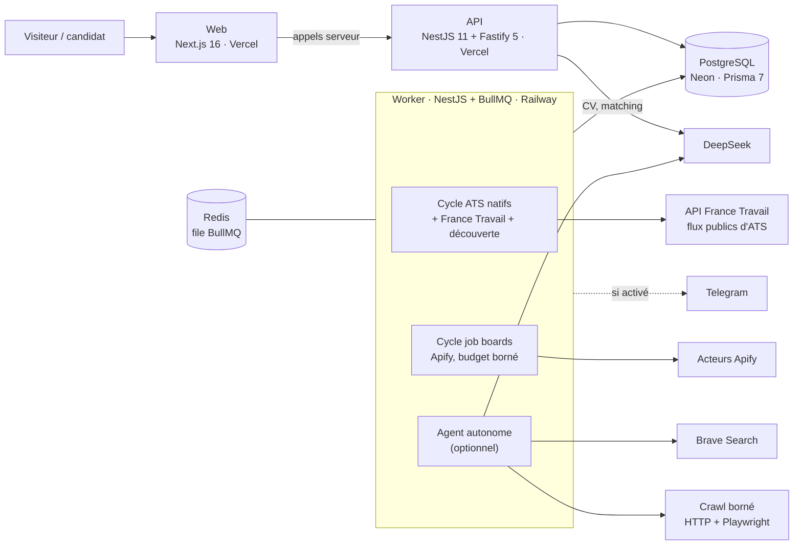
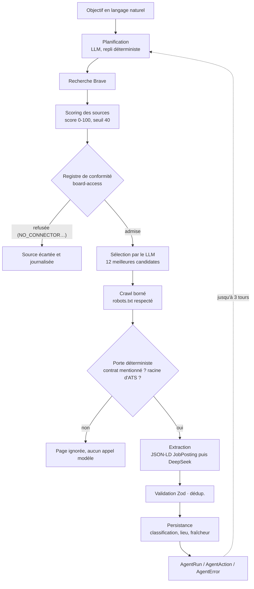

# Findit — Web Intelligence Agent

[](https://github.com/nagoloumdaniel/Findit/actions/workflows/ci.yml)


Un agent qui **découvre, collecte, déduplique et publie des offres d'emploi** en France (CDI, CDD, intérim, stage, alternance, job étudiant), avec un espace candidat : CV, matching CV/offres, génération de CV et de lettre de motivation.

**Site** : [finditfr.vercel.app](https://finditfr.vercel.app) · **API** : `finditfr-api.vercel.app` · Projet personnel, en développement actif.

## Aperçu

> **Capture d'écran manquante.** Aucune capture n'est versionnée dans ce dépôt (seuls `apps/web/public/logoblanc.png` et `logonoir.png` le sont). Pour en ajouter une : déposer un fichier dans `docs/assets/` (par exemple `accueil.png`) et l'insérer ici avec ``.

<!-- TODO(captures) : accueil (liste + filtres), fiche d'offre, espace /moi, dashboard d'exploitation. -->

## Statut

| Élément                  | État                                                                                                                                            |
| ------------------------ | ----------------------------------------------------------------------------------------------------------------------------------------------- |
| Période de développement | du 2026-07-16 au 2026-10-19 (dernier commit)                                                                                                    |
| Web                      | Déployé sur Vercel (projet `finditfr`, racine `apps/web`)                                                                                       |
| API                      | Déployée sur Vercel (projet `finditfr-api`, racine `apps/api`, entrée serverless)                                                               |
| Worker                   | Conçu pour Railway (service `worker` + Redis). **Son état en ligne n'est pas vérifiable depuis ce dépôt** : aucune disponibilité n'est garantie |
| Agent autonome           | Éteint par défaut (`AGENT_RUN_ENABLED=false`) : il dépense de vrais appels DeepSeek et Brave                                                    |
| Disponibilité            | Aucun engagement de service : projet personnel, services gratuits ou bornés en budget                                                           |

## Ce que ça fait

- **Collecte** des offres depuis plusieurs familles de sources : API officielle France Travail, flux publics d'ATS (Greenhouse, Lever, Workable, Workday), job boards via des acteurs Apify (Welcome to the Jungle, HelloWork, Indeed, LinkedIn), et découverte d'entreprises par recherche web (Brave).
- **Classification** par type de contrat (6 valeurs : `ALTERNANCE`, `INTERNSHIP`, `CDI`, `CDD`, `INTERIM`, `STUDENT_JOB`), métier et lieu (France entière), **normalisation** et **déduplication** (similarité de titre/entreprise, décisions écrites en base).
- **Publication** sur un site public : liste, recherche, filtres, fiche d'offre ; fraîcheur de 24 h ou de 5 jours (`LAST_24H`, `LAST_5D`), 5 jours étant un plafond absolu.
- **Espace candidat** (`/moi`) : compte par e-mail, profil, import de CV (PDF/DOCX), favoris, historique de matchings.
- **Matching CV / offres** : structuration du CV par DeepSeek, score déterministe encadré par des garde-fous (`@findit/matching`, `@findit/matching-engine`).
- **Génération de documents** : CV et lettre de motivation en PDF et DOCX (`@findit/documents`, `@react-pdf/renderer`, `docx`).
- **Dashboard d'exploitation** (`/dashboard`) : runs de l'agent, coûts modèle, sources suivies, analytics. Certaines sections (Jobs, Crawls, Logs, Configuration) sont encore des états vides.
- **Alertes Telegram** optionnelles, éteintes par défaut.

## Ce que ça ne fait pas

- **Pas de postulation automatique** : un lien d'origine renvoie vers la source de l'offre.
- **Pas de republication intégrale des offres de job boards** : l'API n'en expose qu'un extrait de 320 caractères et le lien d'origine ; la description complète reste en base et sert au matching.
- **Pas de contournement** de CAPTCHA, de page de connexion ou d'anti-bot, pas de proxys rotatifs, pas de faux user-agent (voir [Conformité des sources](#conformité-des-sources)).
- **Pas de garantie d'exhaustivité** : la couverture dépend des sources actives, de leurs plafonds de budget et de la fenêtre de fraîcheur.
- **Pas de garantie de disponibilité** des instances hébergées.
- Le score de matching est **indicatif**.

## Architecture



Le web ne parle jamais directement à PostgreSQL ou à Redis : il passe par l'API. Les trois planifications du worker partagent une seule file BullMQ en concurrence 1, donc deux cycles ne se chevauchent jamais. Détail : [docs/architecture.md](docs/architecture.md) (instantané du 2026-10-07, voir l'avertissement en tête de ce fichier), [docs/deployment.md](docs/deployment.md).

## Pipeline de l'agent

L'orchestrateur est un **LLM encadré par des outils déterministes** : le modèle choisit les recherches et les sources à visiter ; le crawl, l'extraction, la validation, la déduplication et le stockage sont du code. Si la réponse du modèle est inutilisable, un plan déterministe prend le relais.



Bornes par défaut : 10 requêtes, profondeur 2, 20 pages par source, 50 pages et 5 minutes par run. Une étape qui échoue est consignée et n'interrompt pas le run. En **mode découverte seule** (`AGENT_DISCOVERY_ONLY`), le crawl et l'extraction sont ignorés : le run alimente seulement le registre des entreprises.

Le coût du modèle est relevé à chaque appel. Une porte déterministe placée avant l'extraction a fait passer un run de contrôle de **5 419 à 782 µ$** (mesure du 2026-10-06, voir [docs/architecture.md](docs/architecture.md)) : c'est une mesure ponctuelle sur un run, pas une moyenne.

## Stack

| Couche      | Technologies                                                        |
| ----------- | ------------------------------------------------------------------- |
| Monorepo    | pnpm 11 workspaces, Turborepo 2, TypeScript 6, Node.js 24           |
| Web         | Next.js 16 (App Router), React 19                                   |
| API         | NestJS 11 sur Fastify 5, Helmet, CORS, validation Zod               |
| Worker      | NestJS, BullMQ 5, Redis                                             |
| Données     | PostgreSQL (Neon), Prisma 7 avec l'adaptateur `pg`                  |
| IA          | DeepSeek (structuration de CV, extraction, planification, matching) |
| Collecte    | API France Travail, Brave Search, Apify, Cheerio, Playwright        |
| Documents   | `@react-pdf/renderer`, `docx`, `unpdf`, `mammoth`                   |
| Qualité     | ESLint 10, Prettier 3, Vitest 4, Playwright, GitHub Actions         |
| Hébergement | Vercel (web + API), Railway (worker + Redis)                        |

## Chiffres vérifiés

Relevés dans le dépôt au **2026-10-29**.

| Mesure              | Valeur                                                      |
| ------------------- | ----------------------------------------------------------- |
| Période des commits | 2026-07-16 → 2026-10-19                                     |
| Commits             | 284                                                         |
| Applications        | 3 (`web`, `api`, `worker`)                                  |
| Paquets             | 19 (`packages/*`)                                           |
| Modèles Prisma      | 38                                                          |
| Migrations          | 34 dossiers dans `packages/database/prisma/migrations`      |
| Fichiers de test    | 113 (`*.test.*` / `*.spec.*`, dont les parcours Playwright) |
| Types de contrat    | 6                                                           |

Ces nombres évoluent : les recompter avec `git rev-list --count HEAD`, `ls packages | wc -l`, etc.

## Conformité des sources

Le code ne décide pas seul de ce qu'il peut visiter : une table `Connector` (le **registre de conformité**) porte pour chaque source un statut d'accès `SourceAccessStatus` (`OFFICIAL_API`, `PUBLIC_FEED`, `AUTHORIZED_CRAWL`, `OWNER_ACCEPTED_SCRAPING`, `DISABLED_PENDING_PERMISSION`, `PROHIBITED`…), synchronisé par `pnpm registry:sync`. Une source non autorisée ne s'exécute pas ; un statut dont les conditions n'ont pas été revérifiées depuis plus de 90 jours est refusé.

- **API officielle et flux publics** : France Travail (API officielle, identifiants partenaires requis), Greenhouse et Lever (flux publics), Workable, Workday (`robots.txt` du locataire relu avant chaque collecte).
- **Crawler** : s'identifie (`FinditBot`), respecte `robots.txt`, borne profondeur, pages et durée. Un domaine connu (job board, ATS) doit avoir un connecteur actif ; un domaine inconnu reste gouverné par `robots.txt`.
- **Job boards (Welcome to the Jungle, HelloWork, Indeed, LinkedIn)** : leurs conditions d'utilisation **interdisent la collecte automatisée**. Findit les collecte néanmoins via des acteurs Apify tiers, sous le régime `OWNER_ACCEPTED_SCRAPING` : un accès **toléré, non autorisé**, dont le **propriétaire du projet assume le risque** (blocage d'IP ou de compte, litige civil). Ce régime est distinct d'une autorisation et **ce dépôt ne prétend pas que cette collecte est légale**. Les coûts sont plafonnés par cycle et par mois, et seul un extrait court plus le lien d'origine est publié.
- **Jamais** : contournement de CAPTCHA, connexion ou cookies, proxys rotatifs, falsification du user-agent.
- **Brave Search** ne sert qu'à découvrir des domaines ; ses résultats ne sont pas stockés comme offres.

Si vous êtes ayant droit d'une source et souhaitez son retrait, ouvrez une issue : la source peut être désactivée au registre. Détail complet, par source, avec dates de vérification : [docs/legal-compliance.md](docs/legal-compliance.md). Données personnelles : [docs/politique-confidentialite.md](docs/politique-confidentialite.md).

## Démarrage

Prérequis : Node.js `>= 24.18 < 25`, pnpm 11.13.1 (via Corepack), une base PostgreSQL joignable (Neon en production ; TLS exigé) et, pour le worker, un Redis. Aucun Docker n'est fourni.

```bash
corepack enable
corepack prepare pnpm@11.13.1 --activate
cp .env.example .env     # puis renseigner les variables (jamais de valeur réelle dans Git)
pnpm install
pnpm setup:hooks         # hook anti-secret, une fois
pnpm db:migrate
pnpm registry:sync       # synchronise le registre de conformité
pnpm dev
```

- Web : <http://localhost:3100> · API : <http://localhost:4000> · santé : <http://localhost:4000/health>
- `pnpm db:seed` insère des offres de **démonstration** (`isDemo = true`), pour le développement uniquement.

Variables d'environnement (noms seulement ; toutes sont décrites dans `.env.example` et validées par Zod au démarrage) :

| Usage                | Variables                                                                                           |
| -------------------- | --------------------------------------------------------------------------------------------------- |
| Base et file         | `DATABASE_URL`, `REDIS_URL` (worker)                                                                |
| API et web           | `NEXT_PUBLIC_API_URL`, `CORS_ORIGIN`, `INTERNAL_API_KEY`, `PROFILE_PASSWORD`, `SESSION_SECRET`      |
| IA                   | `DEEPSEEK_API_KEY`, `DEEPSEEK_MODEL`, `DEEPSEEK_INPUT_USD_PER_MTOK`, `DEEPSEEK_OUTPUT_USD_PER_MTOK` |
| Sources              | `BRAVE_SEARCH_API_KEY`, `APIFY_API_TOKEN`, `FRANCETRAVAIL_CLIENT_ID`, `FRANCETRAVAIL_CLIENT_SECRET` |
| Agent et budgets     | `AGENT_RUN_ENABLED`, `AGENT_DISCOVERY_ONLY`, `SCRAPED_SOURCES_ENABLED`, `SCRAPING_BUDGET_*`         |
| Telegram (optionnel) | `TELEGRAM_NOTIFICATIONS_ENABLED`, `TELEGRAM_BOT_TOKEN`, `TELEGRAM_CHAT_ID`                          |
| SEO (optionnel)      | `NEXT_PUBLIC_SITE_URL` (adresse canonique du site, défaut : le déploiement de production)           |

Les clés vivent dans `.env` (ignoré par Git), jamais dans un fichier versionné. L'outillage local qui parle à Redis (`pnpm board:proof`) exige une URL Redis joignable depuis votre machine. Déploiement complet : [docs/deployment.md](docs/deployment.md).

## Qualité

```bash
pnpm format:check
pnpm typecheck
pnpm lint
pnpm test
pnpm build
```

Ces cinq commandes sont la porte de qualité, rejouée par `.github/workflows/ci.yml` sans secret (le `.env.example` suffit : les tests utilisent des doublures). Les parcours Playwright (`pnpm --filter @findit/web test:e2e`) supposent un web et une API en marche avec de vraies offres.

## Structure du monorepo

```text
apps/
  web/      Next.js 16 (port 3100) · racine du projet Vercel `finditfr`
  api/      NestJS + Fastify (port 4000) · racine `finditfr-api`
  worker/   BullMQ : cycles ATS, job boards, agent autonome, Telegram
packages/
  agent/ orchestrator/ crawler/ extract/ persist/    agent de collecte
  job-connectors/ job-normalization/ job-classification/
  job-deduplication/ job-pipeline/                    sources et traitement des offres
  matching/ matching-engine/ documents/               candidat : matching, CV, lettres
  ai/ config/ database/ notifications/ shared/ ui/    socle commun
docs/                                                 architecture, déploiement, conformité
```

## Limites connues

- **Contrôle d'accès à durcir** : le dashboard repose sur la garde du proxy web (`PROFILE_PASSWORD`), et plusieurs routes de l'API (`/api/agent/*`, `/api/matching/*`) sont publiques. N'envoyez pas de données personnelles sensibles à une instance que vous ne contrôlez pas. Pour signaler un problème de sécurité : [SECURITY.md](SECURITY.md).
- **Worker sans port** : sa santé se lit dans ses journaux et dans les `ConnectorRun`, pas par un `GET /health`.
- **Contournement de routage Vercel** : l'API se déploie derrière des relais d'une ligne dans `apps/api/api/`, palliatif d'une limite de routage de la plateforme.
- **Rendement des job boards faible et coûteux** : plafonds de budget par cycle et par mois, résultats variables (l'acteur LinkedIn, par exemple, ignore la zone demandée).
- **Reprise en cascade partielle** : relecture d'une page vide, JSON-LD avant le LLM et relance des échecs sont livrés ; l'appel de connecteurs spécialisés en repli ne l'est pas.
- **Documentation interne en partie datée** : `docs/architecture.md` décrit l'état du 2026-10-07 ; le schéma Prisma et le code font foi.

## Contribuer

Projet personnel, mais les contributions sont bienvenues : lire [CONTRIBUTING.md](CONTRIBUTING.md) et le [code de conduite](CODE_OF_CONDUCT.md). Failles de sécurité : [SECURITY.md](SECURITY.md), pas d'issue publique.

## Développement assisté par IA

Ce projet est conçu et dirigé par son auteur, avec l'assistance d'outils d'IA (Claude Code, Anthropic) pour l'écriture de code, de tests et de documentation. Environ 111 des 284 commits portent un trailer `Co-Authored-By: Claude`. Chaque changement passe par la porte de qualité ci-dessus, mais le code reste à relire comme n'importe quel code : l'assistance IA n'est pas un gage de correction.

## Auteur et contributeurs

[Daniel Nagoloum Talla](https://github.com/nagoloumdaniel) (180 commits sous ce nom, 104 sous le nom d'affichage « Nagoloum » : même personne, même adresse de commit).

## Licence

**Aucune licence n'est définie pour l'instant.** Le code est public et visible, mais sans licence les droits d'auteur restent réservés : vous pouvez le consulter et le forker dans les limites des conditions de GitHub, pas le réutiliser, le modifier ni le redistribuer. Le choix d'une licence appartient à l'auteur.
